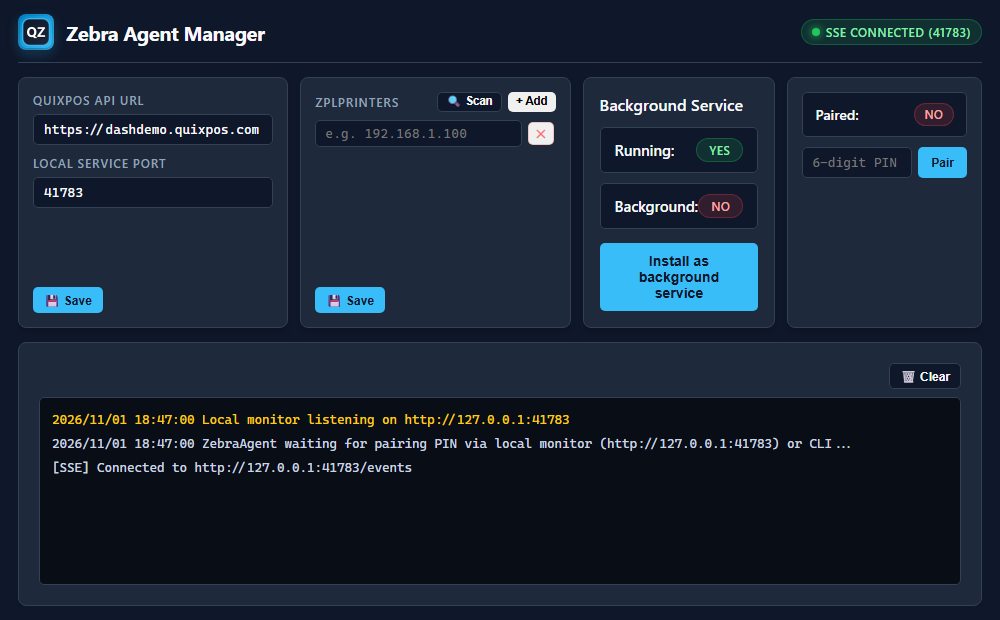

# Zebra Agent Manager

Desktop application and background agent service for connecting local Zebra ZPL printers (TCP 9100 & Bluetooth LE) to QuixPOS.



## Features

- **Connection Settings**: Configure the upstream QuixPOS API URL (defaults to `https://dashdemo.quixpos.com`)
- **ZPL Printers Management**:
  - Add one or more ZPL printer targets (IPv4 addresses).
  - **🔍 Scan**: Automatically scan the local network for online ZPL printers and inspect their **Model** and **Serial Number**.
- **Background Service**: Run the embedded `ZebraAgent.exe` automatically as a Windows service.
- **PIN Pairing**: Pair and unpair the agent with QuixPOS with one click.

## Development & Build

### 1. Build the Go Agent Service

```powershell
cd service
go test ./...
go build -o ZebraAgent.exe .
```

### 2. Run or Build the Tauri Desktop App

```powershell
npm run dev
# or build release bundle:
npm run build
```

### 3. Visual Screenshot Tests (Playwright)

```powershell
# Run screenshot comparison tests
npm run test:ui

# Update reference snapshots
npm run test:ui:update
```

